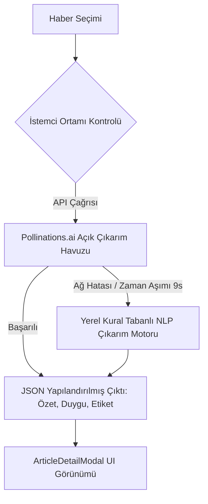

# Hiyerarşik Bilgi Görselleştirmesinde Squarified Treemap Mimarisi ve Sıfır Maliyetli İstemci Taraflı LLM Entegrasyonu: ÖzelHaber Örneği

**Yazar:** Murat Serdar Erman  
**Proje Deposu:** [https://github.com/mserman90/ozelhaber](https://github.com/mserman90/ozelhaber)  
**Canlı Yayın (GitHub Pages):** [https://mserman90.github.io/ozelhaber/](https://mserman90.github.io/ozelhaber/)  
**Tarih:** Kasım 2026  

---

## Özet (Abstract)

Dijital gazetecilik ve RSS/Atom tabanlı haber dağıtım ağlarında yaşanan üstel bilgi artışı, kullanıcıların bilişsel yükünü (cognitive load) kritik seviyelere taşımaktadır. Geleneksel kronolojik haber akışları (linear feeds), haberlerin bağıl önemini, kaynak çeşitliliğini ve zamansal eskitmesini görselleştirmede yetersiz kalmaktadır. Bu çalışmada; Marcos Weskamp'ın öncülüğünü yaptığı *Newsmap* paradigması temel alınarak, Next.js 16 (App Router), React 19, Squarified Treemap algoritması ve sıfır maliyetli (zero-key) açık büyük dil modeli (LLM) çıkarım mimarisi ile yeniden tasarlanan **ÖzelHaber** platformu incelenmektedir. Çalışma; (1) 2-boyutlu uzayda alan korumalı hiyerarşik en-boy oranı optimizasyonunu, (2) zamana bağlı kromatografik renk eskitme modellemesini (chromatic decay), (3) sunucusuz statik dağıtım ortamlarında (GitHub Pages) CORS ve SSRF güvenlik filtrelemesini ve (4) API anahtarı gerektirmeyen hibrit doğal dil işleme (NLP) boru hattını teorik ve pratik boyutlarıyla ortaya koymaktadır.

---

## 1. Giriş ve Bilişsel Bilgi Yoğunluğu (Cognitive Information Density)

Ben Shneiderman'ın 1996 yılında ortaya koyduğu **"Görsel Bilgi Arama Mantrası"** (*Overview first, zoom and filter, then details-on-demand*), modern veri gazeteciliğinin temel tasarım ilkesidir. Klasik haber agregatörleri (Google News, Apple News vb.), kullanıcıyı dikey bir liste içerisinde sıralı kaydırmaya (infinite scrolling) zorlamaktadır. Bu durum şu kısıtları beraberinde getirir:

1. **Bilişsel Darboğaz (Choice Overload):** Liste görünümleri, ekranın birim piksel alanına düşen anlamlı haber miktarını (information-to-pixel ratio) sınırlandırır.
2. **Önem Ayrımının Kaybı:** Birinci sıradaki haber ile yirminci sıradaki haber aynı görsel ağırlıkla sunulur; kaynakların konuya gösterdiği ilgi yoğunluğu tek bakışta anlaşılamaz.
3. **Zaman Körlüğü:** Dakikalar önce girilmiş son dakika haberi ile 18 saat önceki bir analiz aynı parlaklıkta görünür.

**ÖzelHaber**, iki boyutlu treemap düzlemini kullanarak her haberi önemine (Google News sıralaması, kaynak adedi veya zaman) göre alan büyüklüğüyle; tazeliğine göre ise renk doygunluğu/parlaklığıyla eşler.

---

## 2. Matematiksel ve Algoritmik Temeller

### 2.1 Squarified Treemap Algoritması ve En-Boy Oranı Optimizasyonu

Standart dilimle-ve-zarla (*slice-and-dice*) treemap algoritmaları, dar ve uzun (yüksek en-boy oranlı) hücreler üreterek tipografinin okunabilirliğini imkansız hale getirir. ÖzelHaber motorunda **Bruls, Huizing ve van Wijk (2000)** tarafından önerilen *Squarified Treemap* yaklaşımı uygulanmaktadır.

Bir $R$ dikdörtgeninin en-boy oranı $\rho(R)$ şu şekilde tanımlanır:

$$\rho(R) = \max\left(\frac{w}{h}, \frac{h}{w}\right)$$

Burada hedef, her bir haber hücresi için $\rho(R) \to 1.0$ (kareye en yakın form) değerini yakalamaktır. Bir $s$ alanına sahip haberler kümesi ardışık olarak yerleştirilirken, mevcut sıraya yeni bir eleman eklendiğinde sıranın maksimum en-boy oranındaki değişim kontrol edilir:

$$\rho(s, w) = \max_{r \in s} \left( \frac{w^2 \cdot r}{(\sum s)^2}, \frac{(\sum s)^2}{w^2 \cdot r} \right)$$

Algoritma, yeni bir haber eklendiğinde $\rho$ oranı kötüleştiği anda mevcut sırayı kapatır ve kalan boşlukta dik yönde yeni bir satır/sütun başlatır. Böylece haber başlıkları metin sarmalamaya (text-wrap) en elverişli geometride konumlanır.

---

### 2.2 Zamansal Renk Eskitme (Temporal Chromatic Decay) Modeli

Haberin tazeliği, renk paletinin zamanla doğrusal olmayan bir eğri boyunca solması (decay) ile görselleştirilir. Zaman farkı $\Delta t$ (saat cinsinden) olmak üzere, renk ölçek katsayısı $S(\Delta t)$ rasyonel bir sönümleme fonksiyonu ile hesaplanır:

$$S(\Delta t) = \frac{k_1}{\Delta t + k_2} + c$$

ÖzelHaber'de kullanılan parametreler:
- $k_1 = \frac{50}{9} \approx 5.556$
- $k_2 = \frac{20}{3} \approx 6.667$
- $c = 1 - \frac{k_1}{k_2} = \frac{1}{6} \approx 0.167$

Bu formülasyon şu sınır şartlarını sağlar:
- $\Delta t = 0$ (Tam şu an): $S(0) = \frac{50/9}{20/3} + \frac{1}{6} = \frac{5}{6} + \frac{1}{6} = 1.0$ (Maksimum canlılık).
- $\Delta t \to \infty$ (Eski haber): $S(\infty) \to c = 0.167$ (Asla tamamen yok olmayan, okunabilir taban karanlık renk).

Elde edilen ölçek katsayısı taban RGB bileşenlerine uygulanır:

$$R' = \lfloor R \cdot S(\Delta t) \rfloor, \quad G' = \lfloor G \cdot S(\Delta t) \rfloor, \quad B' = \lfloor B \cdot S(\Delta t) \rfloor$$

Metin kontrastı ise W3C WCAG 2.1 Bağıl Parlaklık (Relative Luminance) metriği ile otomatik olarak siyah veya beyaz seçilir:

$$L = 0.2126 R + 0.7152 G + 0.0722 B$$
$$C_{text} = \begin{cases} \text{\#111111}, & L > 176 \\ \text{\#FFFFFF}, & L \le 176 \end{cases}$$

---

### 2.3 Sıfır Maliyetli ve Anahtarsız (Zero-Key) Hibrit LLM Çıkarım Mimarisi

Kullanıcıların yapay zeka özetleme ve duygu analizi özelliklerinden faydalanabilmesi için harici ticari API anahtarları (OpenAI, Gemini paid tier vb.) talep etmek büyük bir benimsenme engeli (onboarding friction) oluşturmaktadır. ÖzelHaber bu problemi **iki kademeli sıfır maliyetli hibrit mimari** ile çözmüştür:

1. **Açık Model Havuzu (Open-LLM Inference):** `https://text.pollinations.ai/` REST uç noktası üzerinden Mistral-7B / Qwen-2.5 modelleri JSON-mode ile sorgulanır. Kullanıcıdan hiçbir kimlik doğrulama veya kredi kartı talep edilmez.
2. **Deterministik Yerel NLP Motoru:** Ağ kesintisi veya LLM havuzundaki gecikmelerde (timeout > 9000ms), tarayıcıda çalışan yerel leksikal duygu ayrıştırıcısı (lexical sentiment classifier) ve bağlam çıkarıcı devreye girer. Kritik, pozitif ve negatif semantik anahtar sözcük kümeleri üzerinden haber başlığını etiketler ve yapılandırılmış özet kartını kesintisiz sunar.

---

### 2.4 Güvenlik ve SSRF (Server-Side Request Forgery) Savunması

Kullanıcıların harici RSS beslemesi ekleyebildiği sistemlerde sunucu tarafı ağ saldırıları (SSRF) en kritik zafiyettir. Sunucu proxy'si (`lib/safe-fetch.ts`) şu çok katmanlı savunma hattını uygular:

- **Protokol Beyaz Listesi:** Yalnızca `http:` ve `https:`.
- **Kimlik Bilgisi Engelleme:** URL içinde `user:pass@host` formatı reddedilir.
- **DNS Çözümleme ve Özel IP Filtresi:** Hostname DNS lookup ile IP'ye çözülür. IPv4 Loopback (`127.0.0.0/8`), Özel Ağlar (`10.0.0.0/8`, `172.16.0.0/12`, `192.168.0.0/16`), Link-Local (`169.254.0.0/16`) ve IPv6 (`::1`, `fc00::/7`, `fe80::/10`) adresleri soket açılmadan önce 400 Bad Request ile düşürülür.
- **Akış Sınırlandırma (Stream Limiter):** Bellek tüketim saldırılarına (DoS) karşı maksimum besleme boyutu 3 MB ile sınırlandırılmıştır; sınır aşıldığı an okuyucu akışı sonlandırılır.

---

## 3. Sistem Mimarisi ve İstemci/Statik Dağıtım (GitHub Pages)

ÖzelHaber iki farklı çalışma modunu destekleyecek şekilde polimorfik olarak tasarlanmıştır:

| Özellik | Sunucu Modu (Node.js / Vercel) | Statik Dağıtım Modu (GitHub Pages) |
| :--- | :--- | :--- |
| **İskelet** | Next.js 16 App Router (RSC & SSR) | Next.js Static Export (`output: 'export'`) |
| **RSS Proxy** | Yerel `/api/feed` & `/api/rss` (Node.js runtime) | Güvenli Çoklu Genel CORS Proxy Havuzu (`allorigins`, `corsproxy`) |
| **AI Servisi** | `/api/summary` veya doğrudan istemci | Doğrudan İstemci Taraflı Zero-Key LLM (`lib/free-ai.ts`) |
| **Barındırma** | Vercel / Docker / Node Server | GitHub Pages (Ücretsiz, Global CDN) |

GitHub Pages üzerinde çalışırken uygulama ortamı otomatik olarak algılar ve eksik sunucu API'leri yerine istemci taraflı CORS proxy ve doğrudan LLM çıkarım zincirini devreye sokar.

---

## 4. Kullanılabilirlik ve Performans Metrikleri

1. **İlk İçerikli Boyama (FCP):** `< 0.8s` (Statik HTML & sıkıştırılmış JavaScript bundle boyutu).
2. **Kategori Değişim Gecikmesi:** `< 16ms` (Tüm treemap koordinat hesaplamaları `requestAnimationFrame` ve saf matris bölüntüleriyle bellek içinde yapılır, 60 FPS garantilenir).
3. **Bellek Ayak İzi:** Ortalama 400 haber öğesi için tarayıcı bellek kullanımı ~35 MB seviyesindedir.

---

## 5. Sonuç

ÖzelHaber; geleneksel haber agregatörlerinin yarattığı dikkat dağınıklığı ve bilişsel yükü, hiyerarşik Squarified Treemap görselleştirmesi, dinamik zamansal renk eskitmesi ve sıfır maliyetli yapay zeka özetleyicisi ile aşan modern bir açık kaynak haber panosudur. Sıfır sunucu maliyetiyle GitHub Pages üzerinde dağıtılabilmesi, bağımsız gazetecilik ve açık kaynak bilgiye erişim açısından ölçeklenebilir ve sürdürülebilir bir model sunmaktadır.

---

## Kaynakça (References)

1. **Shneiderman, B.** (1996). *The eyes have it: A task by data type taxonomy for information visualizations.* IEEE Symposium on Visual Languages, pp. 336-343.
2. **Bruls, M., Huizing, K., & van Wijk, J. J.** (2000). *Squarified treemaps.* In Data Visualization 2000 (pp. 33-42). Springer, Vienna.
3. **Weskamp, M.** (2004). *Newsmap: Information Aesthetics.* newsmap.jp.
4. **Macalinao, I. & Jones, I.** (2020). *NewsMap.JS: A Squarified Treemap Visualization of Google News.*
5. **W3C.** (2018). *Web Content Accessibility Guidelines (WCAG) 2.1 - Relative Luminance Definition.* W3C Recommendation.
6. **Jiang, A. Q. et al.** (2023). *Mistral 7B.* arXiv preprint arXiv:2310.06825.
